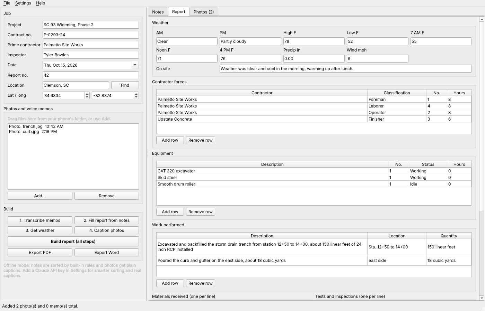

# Field Report Builder

A Windows desktop app that turns a day of site photos and phone voice memos into an inspector's daily work report.

At the end of the day, drag your photos and voice memos onto the window. Field Report Builder transcribes the memos on your own computer with Whisper, sorts what you said into the report sections (contractor forces, equipment, work performed with stations and quantities, materials, tests, visitors, delays, safety), pulls the day's weather for the site, captions the photos, and exports the report as a PDF and an editable Word file with a signature block.

> Student-built tool. Check every line of a report before you sign it.



Sample output: [PDF](docs/sample-daily-report.pdf) and [Word](docs/sample-daily-report.docx), built from the example day the app opens with.

## Download

Grab `FieldReportBuilder-windows.zip` from the latest [release](../../releases/latest), unzip it anywhere, and double-click `FieldReportBuilder.exe`. No install, no Python needed. Windows SmartScreen may warn because the exe is unsigned; choose "More info" then "Run anyway".

The first time you transcribe a memo the app downloads the Whisper model (about 150 MB for the default) into `%LOCALAPPDATA%\FieldReportBuilder\models`. After that, transcription works with no internet.

Every push to `main` also builds the zip as a GitHub Actions artifact.

## How it works

| Step | What happens | Needs |
| --- | --- | --- |
| Add files | Photos and memos dropped on the list. Photo EXIF gives the time each was taken and the GPS location; the first GPS photo sets the site location and the photos set the report date. iPhone HEIC photos work. | Nothing |
| 1. Transcribe | [faster-whisper](https://github.com/SYSTRAN/faster-whisper) runs Whisper on the CPU (int8) with a prompt of site vocabulary (stations, RCP, slump, proof roll). Choose tiny, base or small in Settings. | Nothing after the first model download |
| 2. Fill report | With a Claude API key, Claude Sonnet fills the report through a forced tool call whose schema is the report, told to use only what you said and keep your wording. Without a key, a rule-based sorter does it (number words, trades, equipment, stations, quantities, keyword sections). | Optional Claude key |
| 3. Weather | [Open-Meteo](https://open-meteo.com/) for the report date at the site: AM and PM conditions, 7 AM, noon and 4 PM temperatures, high and low, rain, wind. Type a town and press Find if your photos have no GPS. | Internet, no key |
| 4. Captions | With a key, Claude looks at a downsized copy of each photo plus your notes and writes one factual sentence. Without a key, a plain caption with the GPS point. | Optional Claude key |
| Export | PDF (ReportLab) and Word (python-docx) in the usual DOT daily report layout, photos two per row in time order, signature block for the inspector and the reviewing engineer. | Nothing |

Everything stays editable: the tables, the lists, the weather and each caption. Save a day as a `.frb.json` file to come back to it.

## Verification

`tests/` (pytest) covers:

- The offline sorter on a full example day: 4 crew rows with counts and hours, 3 equipment rows with working and idle status, 2 work items with stations and quantities, and every text section
- Number words, "nine and a half hours", station ranges like `sta 101 + 00 through station 104+50`, equipment marked down
- The Claude path with a mocked API: forced tool call, model name, bad values coerced, fallback to the rules when the API fails
- Open-Meteo parsing from a saved response, forecast vs archive endpoint choice, picking Clemson SC over Clemson NC
- EXIF time and GPS, sideways phone photos turned upright, photo order by time
- PDF and Word exports contain every section and both photos; an empty report still exports; save and load round trip
- The window: adding files, hand edits to tables and captions read back, export

The GitHub Actions workflow also runs live checks on Windows: it records a spoken memo with Windows text-to-speech, transcribes it with Whisper in the tests and again with the packaged exe, and calls the real Open-Meteo API.

```
pip install -r requirements.txt
python -m pytest
```

## Run from source

```
pip install -r requirements.txt
python -m field_report_builder
```

## Build the app yourself

```
pyinstaller packaging/field_report_builder.spec --noconfirm
```

The app lands in `dist/FieldReportBuilder/`. The workflow in `.github/workflows/build.yml` does the same on `windows-latest`, self-tests the exe, zips the folder and attaches it to a release when run with a `release_tag`.

## Claude API key

Settings > Claude API key. The key is stored in `%APPDATA%\FieldReportBuilder\settings.json`. Only your transcript (for sorting) and downsized photos (for captions) are sent to the Anthropic API, and only when you press those steps. Audio never leaves your computer.

## Layout

```
field_report_builder/
  model.py        the report (crews, equipment, work, weather, photos) and .frb.json save/load
  transcribe.py   faster-whisper speech-to-text
  extract.py      notes to report fields: Claude tool call or the offline sorter
  weather.py      Open-Meteo weather and town lookup
  photos.py       EXIF time and GPS, upright downsized JPEGs, captions
  layout.py       what goes on the page, shared by both exports
  report_pdf.py   PDF export (ReportLab)
  report_docx.py  Word export (python-docx)
  claude.py       settings file and a small Claude API client
  sample.py       the example day and sample photos
  ui/             PySide6 window
tests/            pytest suite
packaging/        PyInstaller spec
```

## License

MIT.
